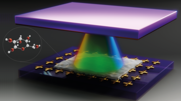
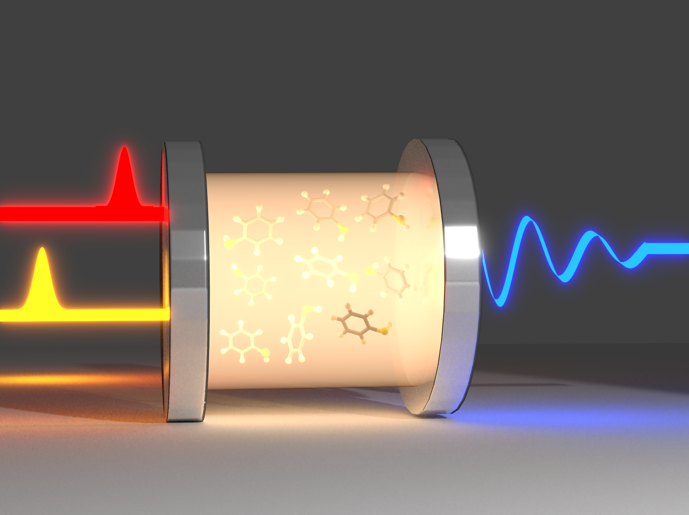
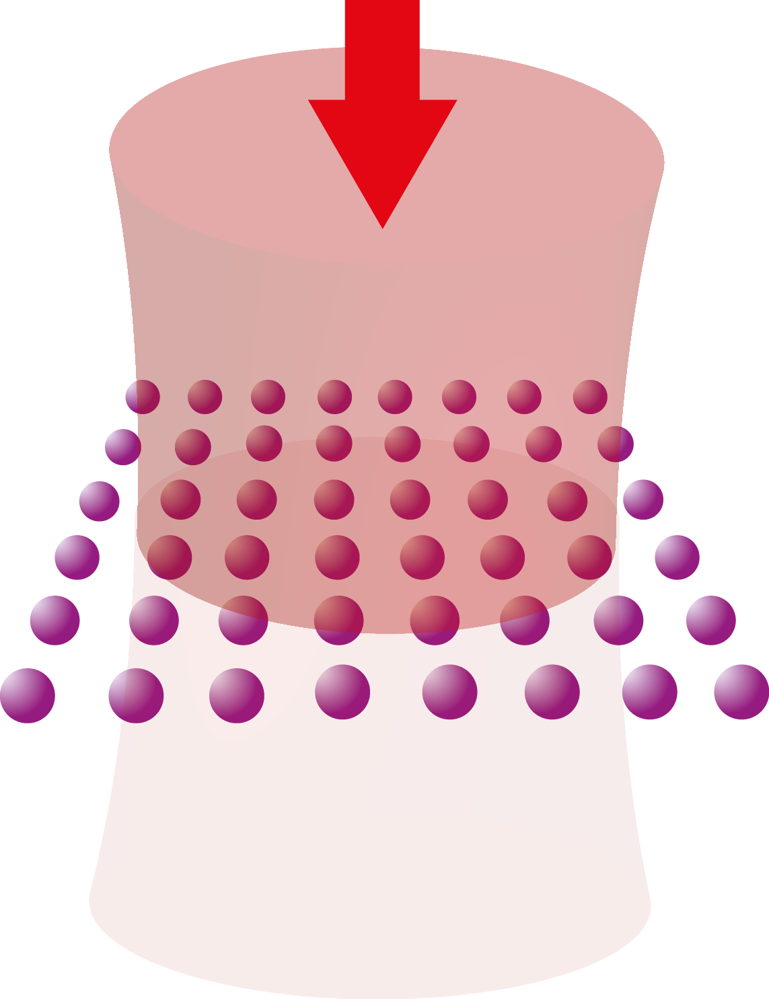
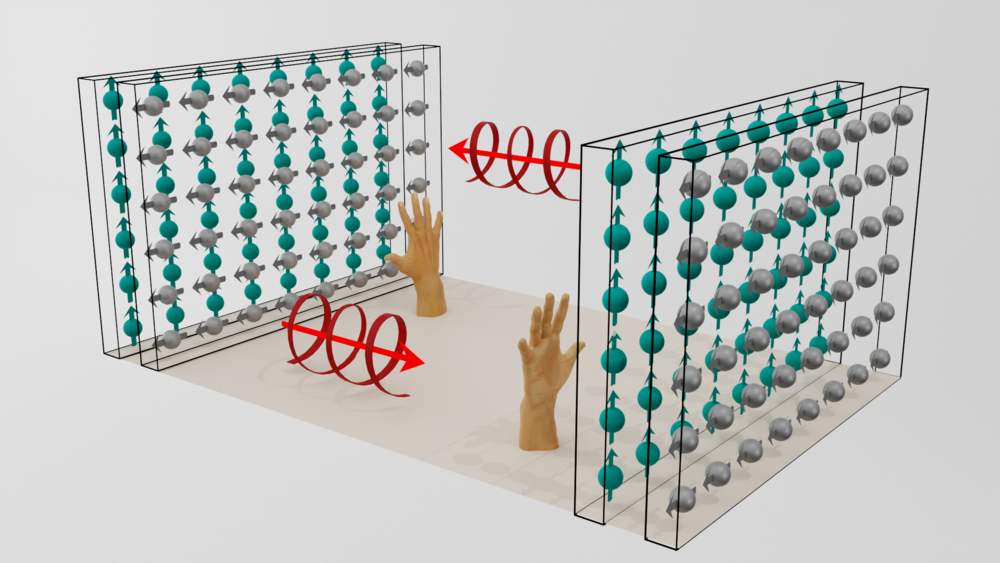

## Research

### Strong light-matter coupling

When light and matter interact strongly, they hybridize to form quasiparticles known as polaritons. These hybrid excitations combine the low effective mass and rapid propagation of photons with the nonlinearities and interactions inherited from their matter counterparts. We investigate the fundamental properties (e.g., propagation) of these hybrid states, and explore how their properties can be exploited toward the development of novel polaritonic devices.

  

*A terahertz cavity is formed by a mirror (top) interfaced with a metasurface (bottom), achieving strong light-matter coupling with glucose. Figure credit: Alexandra Genes, Genes design.*

**Selected publications:**
- [Nanophotonics **15**, e70249 (2026)](https://onlinelibrary.wiley.com/doi/full/10.1002/nap2.70249)
- [Nature Communications **15**, 48764 (2024)](https://www.nature.com/articles/s41467-024-48764-6)
  
---

### Ultrafast nonlinear polariton spectroscopy

Nonlinear optical spectroscopy provides a powerful means of accessing the microscopic dynamics of hybrid light-matter systems. We develop quantum and semiclassical theoretical frameworks to describe and understand the nonlinear optical response of polaritons. In particular, we investigate how ultrafast spectroscopic techniques can be used to isolate coherent effects in molecular polaritons. 

  

*Laser pulses enter an optical cavity containing an ensemble of molecules. Figure credit: Arghadip Koner.*

**Selected publications:**
- [Phys. Rev. Lett. **134**, 193803 (2025)](https://journals.aps.org/prl/abstract/10.1103/PhysRevLett.134.193803)
- [Nano Lett. **26**, 19, 6334–6340 (2026)](https://pubs.acs.org/doi/10.1021/acs.nanolett.6c00326)

---

### Cooperative light scattering in atomic arrays

The radiation emitted or scattered by ensembles of interacting emitters, for example when arranged in ordered arrays, can differ fundamentally from that of individual emitters. Photon-mediated interactions between emitters give rise to collective phenomena such as superradiance, subradiance, and directional light scattering. We explore how these effects can be harnessed to control the propagation of light in novel quantum metasurfaces.

  

*An array of atoms is illuminated by an incident light beam.*

**Selected publications:**
- [PRX Quantum **3**, 010201 (2022) (Tutorial article)](https://journals.aps.org/prxquantum/abstract/10.1103/PRXQuantum.3.010201)
- [Optics Express **31**, 6003 (2023)](https://opg.optica.org/oe/viewmedia.cfm?uri=oe-31-4-6003&html=true)

---

### Chiral sensing and resolution

Chirality is a fundamental property of many molecules and plays a central role in chemistry and biology. However, distinguishing between molecular enantiomers remains a challenging task. We investigate novel approaches to enantiomer discrimination by engineering either the external electromagnetic environment of chiral molecules, for example through helicity-preserving metasurfaces and optical cavities, or by exploiting internal molecular degrees of freedom, such as spin. 

  

*A helicity-preserving cavity formed by double-layered metasurface mirrors, which can be used for the sensitive detection of chiral molecules. Figure credit: Alexandra Genes, Genes design.*

**Selected publications:**
- [Phys. Rev. Lett. **132**, 043602 (2024)](https://journals.aps.org/prl/abstract/10.1103/PhysRevLett.132.043602)
- [J. Am. Chem. Soc. **147**, 11502 (2025)](https://pubs.acs.org/doi/full/10.1021/jacs.5c11502)
